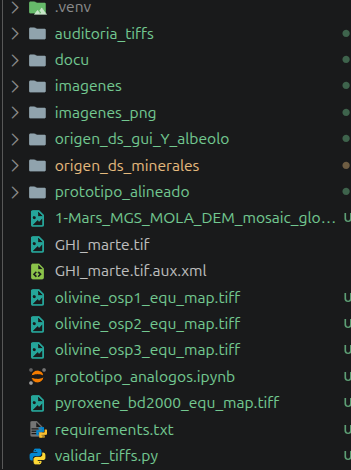
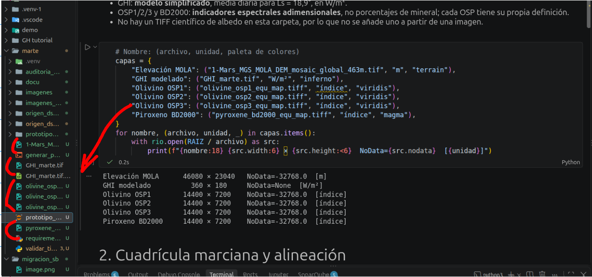
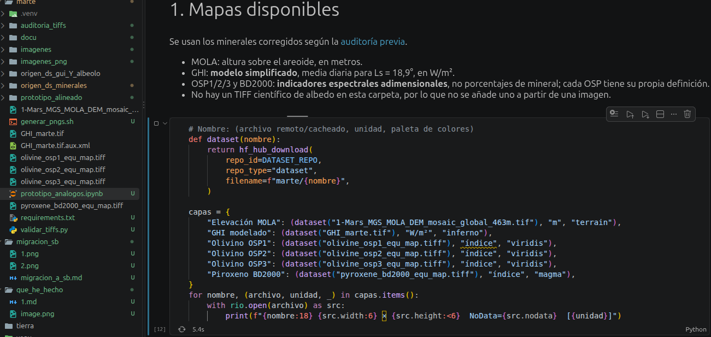

dado el mega caos lo voy a pasar a supabse para que podais abrirlo sin tener que descargar nada

* OS HACEIS UNA CUENTA EN hugging face

Moveros a la carpeta spaceH
- si sois de linux
    - python3 -m pip install -U huggingface_hub
hf auth login
* si sois de windows:
    - python3 -m huggingface_hub.commands.huggingface_cli login

+ si os faltan dependecias haceis el sudo apt que os pidan y a chuparla

+ genere token para tener mi hf, y se lo puse global para tenerlo en todos los repos
- git config --global credential.helper store

---

---

## El cambio de Local - nube

### imagen de local

### imagen de nube

añadi:  
from huggingface_hub import hf_hub_download

