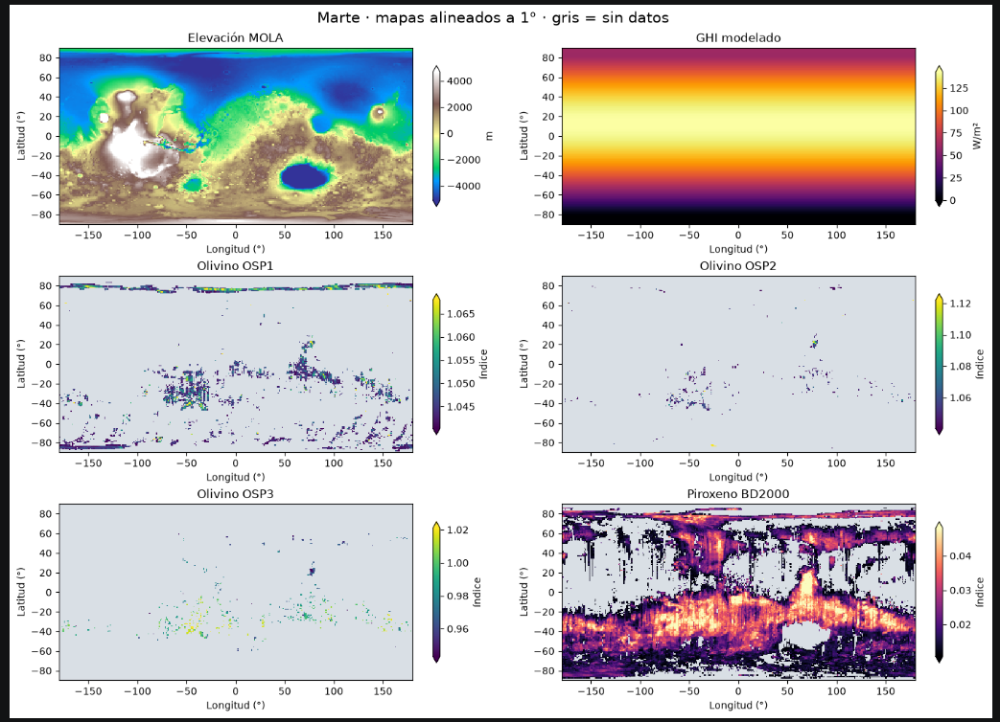

que he hecho
- he tratado de sacar las variables indespensables
    - a partir de ellas de ellas podemos sacar las otras

- el gui(radiacion toal recibida en la superficie) y el albeolo(capacidad de la superficie, en %, de reflejar esa radiacion)
    - gui depende del tiempo --> se seule usr otra extension, pero al final he usado el tif (no tiene la variable tiempo), usando la media (average)
    - albeolo - se permite bondad - poca resolucion 
        - por eso estos 2 tifs los eh sacado a base de scripts

- el tif del MOLA (topología)
    - lo he sacado de internet

- el tiff de los minerales
    - han sido insoportables: [aqui esta la info](../marte/docu/minerales_ds.md)
    - los .img y los LBL me los he guardado en local - pero no os hacen falta

- he creado los siguientes scripts
    - un script que hace una auditoria de los datasets 
        - media/decir si sus valores tenian sentido para las variables que median 
        - medir/decir si se puede trabajar con los datasets EN CONJUNTO
        - si estaban bien cuadrados
            - me detecto que por ejemplo: que no tenia cuadrados los .tiff de los minerales por 1 px arriba y otro izq
    
    - cree un notebook de python que hace los primeros pasos de implementacion de los dataset que ya tenemos
        - la implementacion la hace la IA, no nos podemos aprender a usar las librerias esas en 2 dias pero teneis que tener muy claro lo que hace
            - en esencia use estas librerias:
                - numoy (para mates)
                - matplotlib (para crear diagramas de los tif y que podamos ver la imagenes)
                - rasterio
        - este script
            - llama a los datasets
            - LOS ALINEA
                - porque no todos los pizeles cubren los mismos Kilometros
            - y los representa
            - (eso por ahora)

- para dejarlos de lios he intentado poner los tiff en la nube
    - para no tener cada uno los tif en local
    - superbase lo configure pero me hacia pagar
    - encontre que los de huggin face estan zumbaos y nos dejan crear gratis Dataset de 500GB
        - he puesto los dataset en publico
        

## SIGUIENTE PASOS

Sara y Paula
- El la carpeta tierra
    - os aconsejo usar o poner las tiffs de la variables necesarias en local en el repo
        - hacerles una auditoria con la ia como yo hice para que podamos trabjar con ellas
    - crearles un python notebook 
        - que use los tiff y los represente
    - cuando este todo okey me avisais y juntos los subimos a hugging face
    
Manu, Oscar y Alberto
Los demás ya podeis ir experimentando con los tif de marte que yo ya tengo
- por favor, ir haciendo la implementacion en notebook de python documentando todo bien Y ENTENDIENDOLO
- tambien ir pensando en algoritmos para cuando los dataset de la tierra esten limpios
    - usar la libreria de qgis o lo que sea que useis
